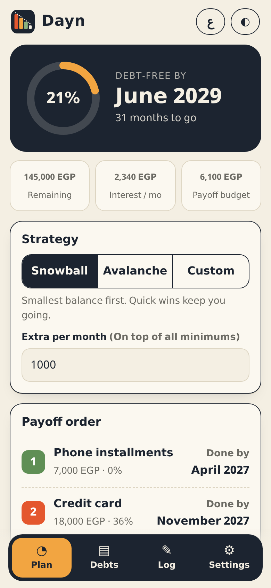
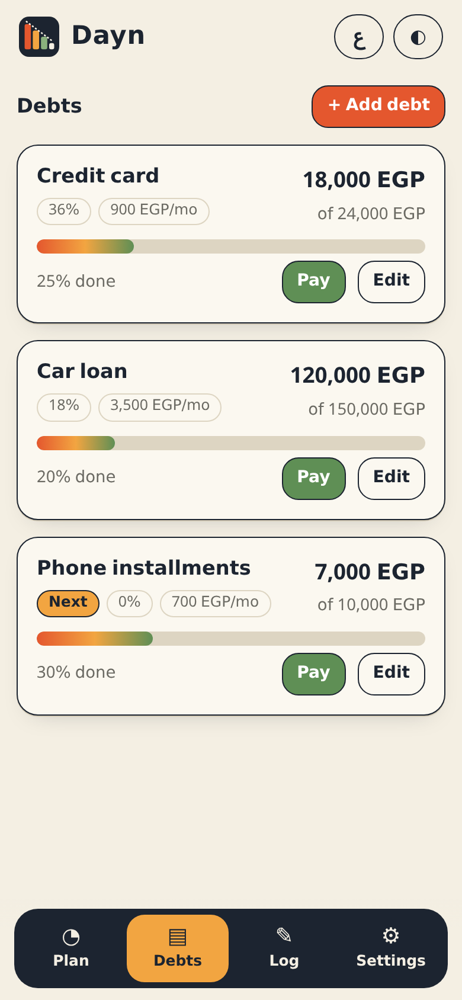
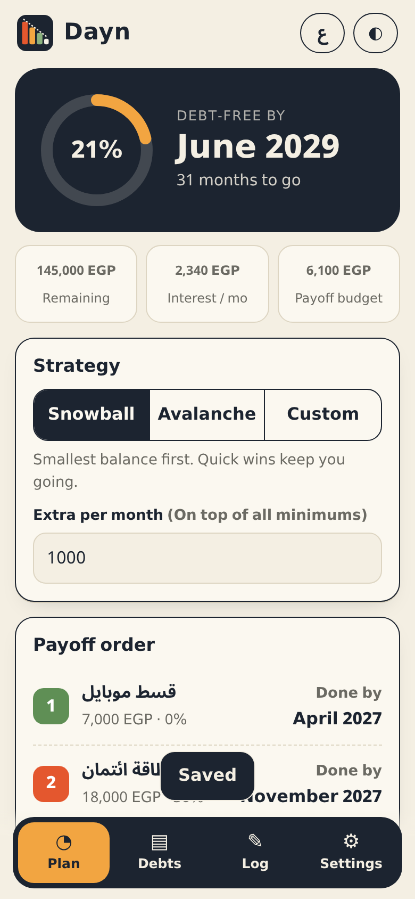

<p align="center"></p>

<h1 align="center">Dayn | دَين</h1>
<p align="center"><b>See the exact month you become debt-free.</b><br>Debt payoff planner with snowball, avalanche and custom order. Arabic and English, works offline, nothing leaves your phone.</p>

<p align="center"><a href="https://yousefkhames.github.io/dayn/"><b>Live demo</b></a> · MIT license</p>

<p align="center">



</p>

## Pitch

Most debt apps want an account and your bank login. Dayn wants four numbers per debt: balance, yearly interest, minimum payment, and what extra you can add each month. It then shows the month you finish, how much interest you save, and keeps you going with milestones and a payment streak.

## Features

- **Three strategies**: snowball (smallest balance first), avalanche (highest interest first), or your own order with arrows. Side-by-side comparison of date and total interest.
- **Projected debt-free date** and per-debt payoff dates. Freed-up minimums roll into the next debt.
- **What if?** slider to try an extra monthly amount and see the date and interest change before you commit.
- **Balance chart** of your plan against paying minimums only.
- **Warnings** when a minimum is below the monthly interest, and when a plan can never finish.
- **Log payments** (reduces the balance, delete one to undo), a "this month" minimums checklist, a monthly streak, and 10/25/50/75/100% milestones.
- **Motivation**: daily rotating quote, progress ring, celebration when a debt is cleared.
- **Arabic and English** with full RTL layout, light and dark theme, any currency label.
- **Export and import** a JSON backup, copy a plan summary, installable PWA with offline cache.

## Tech

Plain HTML, CSS and JavaScript. No framework, no build step, no dependencies, no network calls. The payoff maths is a pure module (`engine.js`) tested in Node. State lives in `localStorage`.

## Run and test

```sh
python3 -m http.server 8000   # then open http://localhost:8000
node tests/engine.test.js     # 20 engine tests
# browser click-through (needs Chrome and puppeteer-core):
PUPPETEER_PATH=/path/to/node_modules/puppeteer-core tests/run.sh
```

The engine tests check results against a closed-form loan formula, rollover, strategy ordering and edge cases. The browser test drives the real app on a phone-size viewport: adding, editing and deleting debts, strategies, what-if, payments, undo, import, language, theme, persistence and XSS escaping.

## Honest limits

- GitHub Pages is a demo host. Data is stored per browser and per device. Clearing site data erases it, and there is no sync. Use Export.
- It assumes a fixed rate, interest compounding monthly (APR / 12) and payments made on time. Real lenders differ in day counts, fees and promo rates, so treat dates as estimates.
- Logging a payment lowers the balance, but interest is not added automatically between payments. Edit the balance to match your statement now and then.
- It is a planning tool, not financial advice.

## License

MIT, see [LICENSE](LICENSE).
